# 0004 · Vibrant palette: one joyful fuchsia on clean neutrals

- **Status:** accepted
- **Date:** 2026-11-11
- **Supersedes:** the palette parts of [0001](./0001-visual-system.md) (warm palette, warm dark mode). The rest of 0001 (three token layers, contrast tests, CSS Modules, Radix, bilingual Storybook, self-hosted Figtree) stands.

## Context

The original palette (sand, terracotta, sage, brick and amber, with a brown dark mode) looked too much like Anthropic's and Claude's interfaces, so Hogar had no visual identity of its own. The goal was a younger look in the spirit of N26: clean neutrals and one confident brand color, here a vivid fuchsia between Barbie pink and the Pink Panther.

That conflicted with the constitution's design goal ("warmth and comfort"), so the constitution was amended first (3.0.0): Principle VI is now "Joyful and Accessible Design", with the goal "joyful and approachable". Lowering tension around money and chores is unchanged.

## Decision

- **One brand color.** A vivid fuchsia, `#EB2386`, used as is for the logo, the focus ring and, in the dark theme, primary buttons with dark text. Wherever white text sits on the brand, a deeper shade is used (`#C2126A`, 5.85:1).
- **Clean neutrals with a plum tint.** Light theme: off-white page `#FBF8FA` and white cards. Dark theme: near-black plum `#141016`.
- **States away from the brand hue.** Teal for positive, an orange-leaning coral for negative (never red, and never mistaken for the fuchsia), and a cleaner amber for warnings.
- **Members are never pink.** Eight member colors with the same luminance and saturation, none in the pink or magenta range. Tests check both.
- **One brand surface per screen.** `Card` gets a `tone="brand"` that redefines the semantic tokens for its subtree, so text, buttons, spinners and the focus ring adapt with no new variants. The home money card is the only place that uses it; a decorative arrow echoes the balance sentence, because state colors don't read on fuchsia.
- **Brand assets.** The logo keeps its shape and becomes fuchsia with a white house. The mobile browser bar follows the active theme.
- **Semantic token names don't change.** Only the primitives behind them do (`fuchsia`, `ink`, `plum`, `teal`, `coral`, `amber`), plus four new brand tokens.

## Before and after

Captured with `pnpm --filter @hogar/web capture` (stubbed data, 390 px wide).

| Screen       | Before (light)                                                             | After (light)                                                            | Before (dark)                                                            | After (dark)                                                           |
| ------------ | -------------------------------------------------------------------------- | ------------------------------------------------------------------------ | ------------------------------------------------------------------------ | ---------------------------------------------------------------------- |
| Home         | 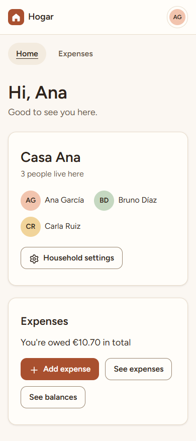                 | 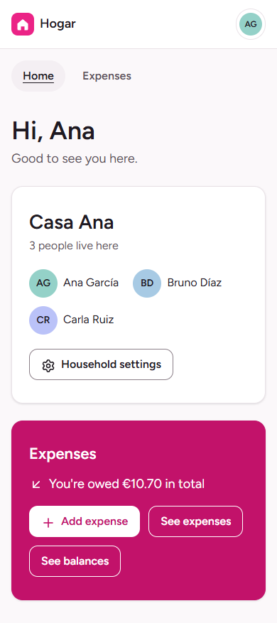                 | 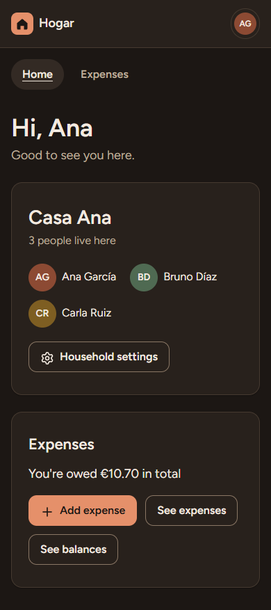                 | 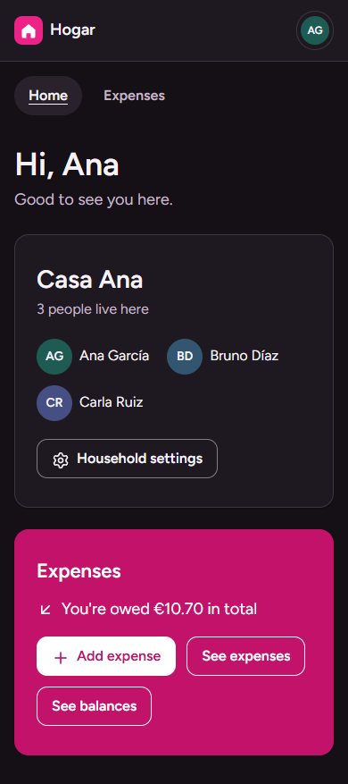                 |
| Balances     | 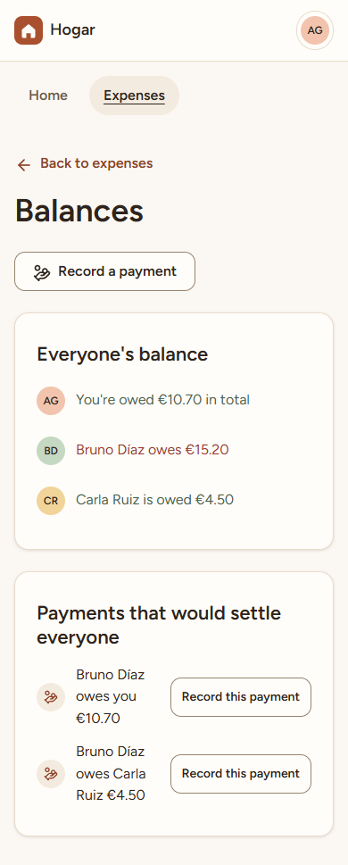         | 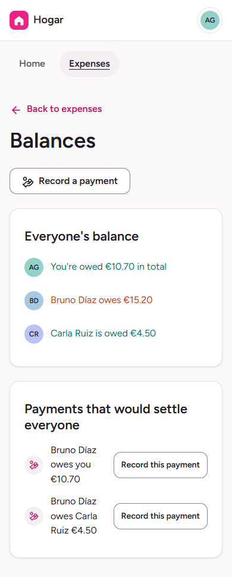         | 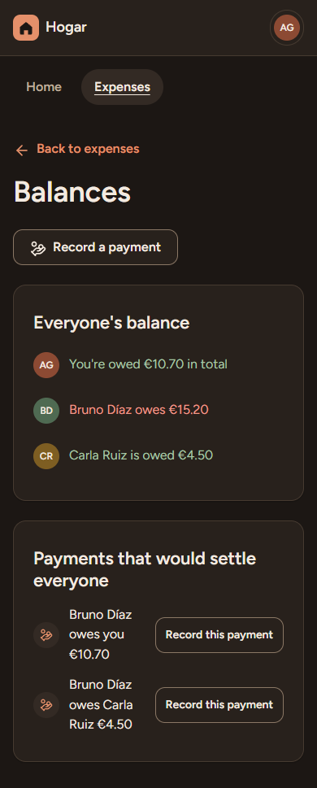         | 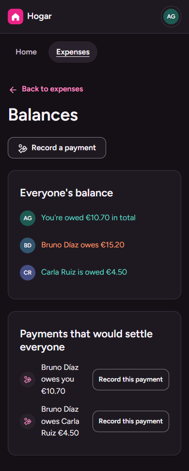         |
| Expense form | 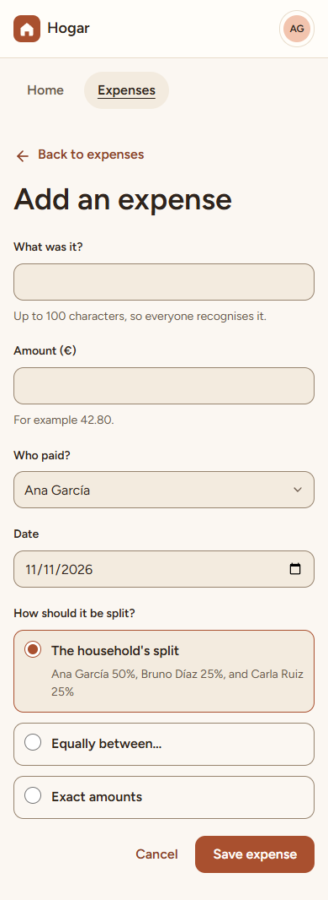 | 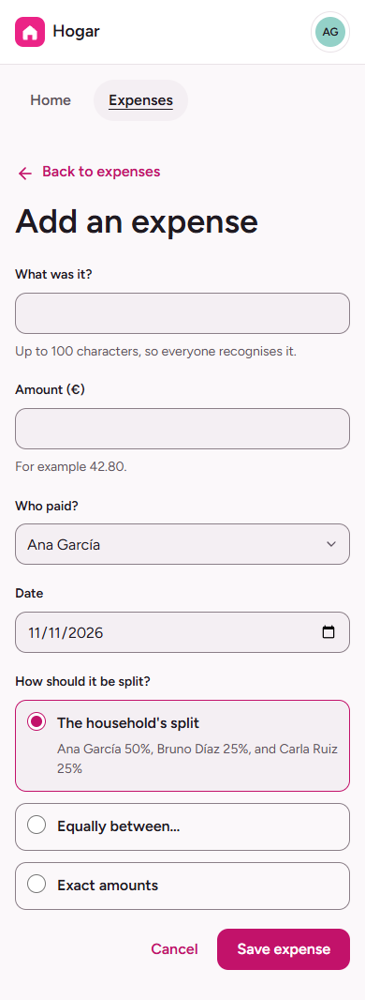 | 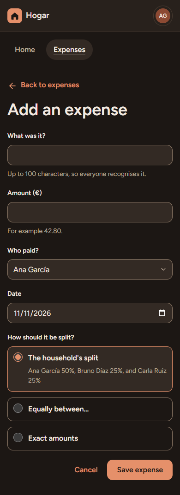 | 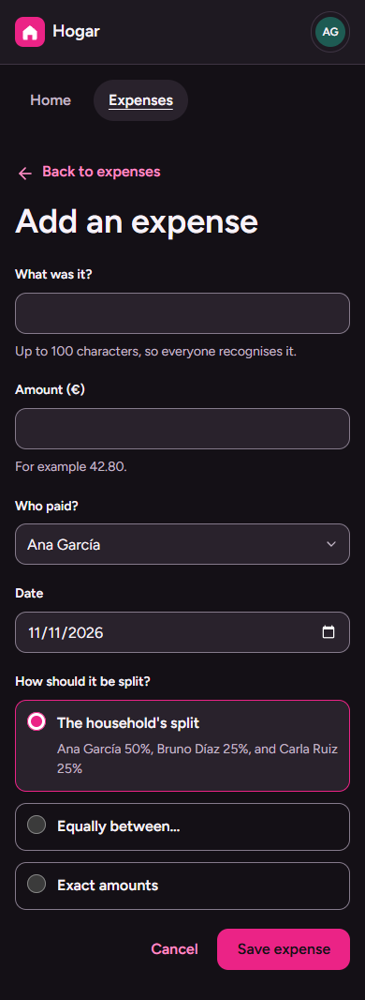 |
| Login        | 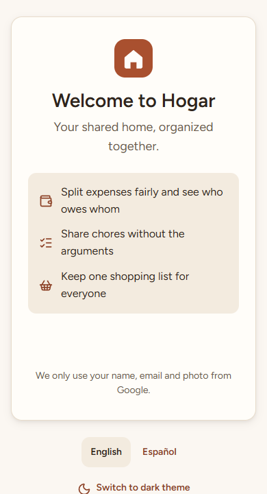               | 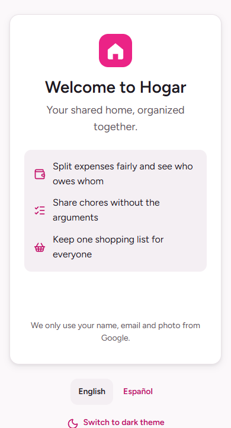               | 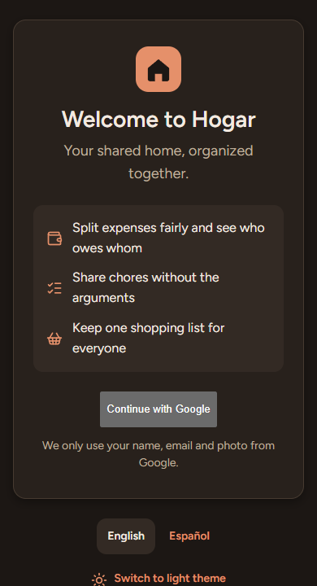               | 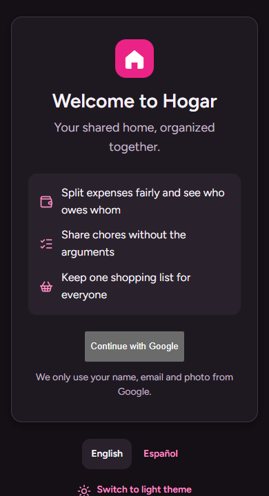               |

## Consequences

- The change was mostly values: components and pages kept their semantic tokens, so only the token files, `Card` and the home page touched color plumbing.
- The vivid tone moved from the first proposal (`#E6197F`) to `#EB2386`: with dark text on dark-theme buttons the original reached only 4.31:1, below AA.
- Scoped token overrides (layer 3 of the token model) are now used for the first time. Anything placed inside a brand card must rely on semantic tokens to adapt, and must not use the state colors.
- Pure white surfaces exposed a bug in the contrast helpers (production CSS shortens `#ffffff` to `#fff`), fixed with a test.
- A second place mirrors the palette besides Storybook: the browser-bar colors in `apps/web`. A test compares them with `primitives.css`.
- What is evidence and what is intent: contrast ratios, equal member luminance and hue separation are measured and tested. That fuchsia feels young and joyful is design intent, and depends on culture and person.
